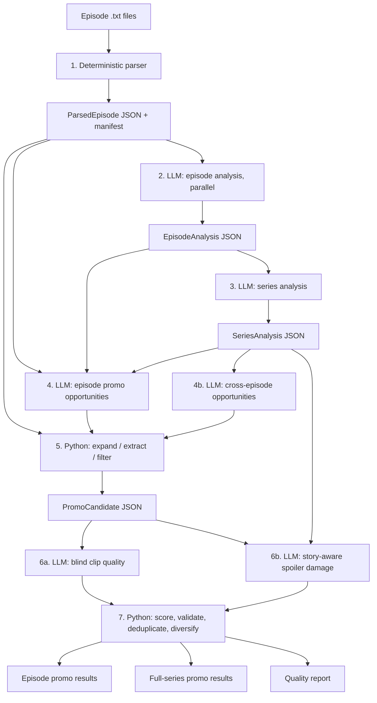

# PromoFinder — Screenplay-to-Promo Discovery

> **Goal:** Read timestamped microdrama screenplay `.txt` files and discover, explain, and rank **20–60-second** promotional clips for **every episode** and for the **full series**. A promo can contain one continuous segment or multiple ordered segments, including segments from different episodes. This tool identifies clips; it does **not** edit video.

## 1. MVP scope and design principles

- **Input:** one screenplay `.txt` per episode, with episode metadata, scene start/end, overlapping `CAMERA`, `ACTION`, and character dialogue blocks, each with timestamps (`MM:SS.ss` or `HH:MM:SS.ss`).
- **Outputs:** `episode_<n>_promos.json` for every episode, `series_promos.json`, and a human-readable `report.md` (ranked recommendations and failure analysis).
- **Priority:** quality and recall first; speed/cost second. Favor strong clips with a compelling event in the **first 3 seconds**, a genuinely **unresolved ending**, independent comprehensibility, and reasonable spoiler exposure.
- **Internal source of truth:** parsed JSON containing original event text, integer-millisecond timestamps, and stable IDs. **LLM requests use compact line-oriented text** with short event references. **LLM outputs use strict JSON schemas.**
- **Ownership:** LLMs select narrative moments and judge creative effectiveness; Python owns ID mapping, timing, clip construction, validation, caching, deduplication, and final ranking.
- **Do not fabricate footage:** if the script is incomplete or a candidate intersects missing text, mark it invalid. Parsed screenplays supply **script timestamps**, which may not exactly match released-video timings; do not claim frame-accurate video cuts without alignment to footage.
- **MVP:** continuous, same-episode candidates fully supported. Support ordered multi-segment/cross-episode candidates with the same data model; add a limited cross-episode generation pass. More elaborate agentic boundary optimization is **post-MVP**.

## 2. Architecture



**Execution order:** Parse all → analyze episodes in parallel → analyze series → discover episode and series opportunities → generate candidate windows in Python → blind evaluation + separate story-aware spoiler evaluation → validate and rank → export. Cache every intermediate result. Run episode candidate generation once analyses are available; series analysis helps but should not block local discovery unnecessarily.

## 3. Project structure

```text
promofinder/
├── data/
│   ├── raw/episode_001.txt
│   ├── parsed/episodes/episode_001.json
│   ├── parsed/series_manifest.json
│   ├── analysis/episodes/episode_001.json
│   ├── analysis/series.json
│   ├── candidates/episode_001.json
│   └── outputs/{episode_001_promos.json,series_promos.json,report.md}
├── src/
│   ├── config.py
│   ├── schemas.py
│   ├── parser.py
│   ├── compact.py
│   ├── llm_client.py
│   ├── episode_analyzer.py
│   ├── series_analyzer.py
│   ├── discover.py
│   ├── candidate_builder.py
│   ├── evaluate.py
│   ├── rank.py
│   ├── report.py
│   ├── pipeline.py
│   └── api.py
├── prompts/{episode_analysis,series_analysis,episode_discovery,series_discovery,blind_evaluation,spoiler_evaluation}.md
├── tests/{test_parser,test_windows,test_validation,test_contracts}.py
├── .env.example
├── pyproject.toml
└── README.md
```

## 4. Step 1 — deterministic screenplay parser (no LLM)

**Input:** `data/raw/episode_001.txt`.

**Extract:** episode number, logline, continuity notes, scene number/heading/start/end, event kind, exact event text, speaker and delivery (dialogue), start/end timestamps, original source line range. Preserve *overlapping* camera/action/dialogue events; never add their durations together.

**Output contract — `ParsedEpisode` (`data/parsed/episodes/episode_001.json`):**

```json
{
  "schema_version": "1.0",
  "episode_id": "ep_001",
  "episode_number": 1,
  "metadata": {
    "logline": "Lady Juliana arrives at the cathedral ...",
    "continuity_notes": "First episode ..."
  },
  "source": {"file": "episode_001.txt", "sha256": "<computed-hash>", "complete": true},
  "scenes": [
    {"id": "sc_001", "heading": "INT. CATHEDRAL – DAY", "start_ms": 0, "end_ms": 138000}
  ],
  "events": [
    {"id": "e_001", "scene_id": "sc_001", "type": "camera", "start_ms": 0, "end_ms": 4800,
     "text": "Symmetrical framing on the heavy church doors ...", "source_lines": [11, 12]},
    {"id": "e_008", "scene_id": "sc_001", "type": "dialogue", "start_ms": 11300, "end_ms": 13100,
     "speaker": "MATRIARCH", "delivery": "Cold, Commanding",
     "text": "You should turn around, Juliana.", "source_lines": [45, 47]}
  ],
  "warnings": []
}
```

All IDs, file hashes and line numbers are **assigned by Python**; displayed line numbers are illustrative. `source.complete` must be set based on the **actual file**, not a declared scene end. If a scene declares `02:18` but the text stops at `00:13.2`, treat it as incomplete for that scene. Parse failures become warnings/errors, not guessed events.

**Series manifest:** `{ "series_id": "series_001", "episodes": [{"episode_id":"ep_001","number":1,"file":"episodes/episode_001.json","duration_ms":138000}] }`; build it from successfully parsed inputs.

**Validation:** `0 <= start_ms < end_ms <= scene.end_ms`; unique IDs; valid scene references; episode order consistent. Allow event overlap. Enforce coverage checks before judging any candidate from an incomplete region.

## 5. Compact LLM input format and ID policy

Persist verbose JSON, but **never send it whole by default**. Render only needed fields into a compact text payload. Example from the provided excerpt (some text abbreviated for illustration):

```text
EP=1
LOGLINE=Juliana arrives at her wedding and faces betrayal.
SCENE S1 00:00.00-02:18.00 INT. CATHEDRAL - DAY
E1 00:00.00-00:04.80 CAM: Church doors part; Juliana framed in white gown.
E2 00:01.00-00:04.80 ACT: Juliana pauses in her mother's gown.
E6 00:09.80-00:11.00 CAM: Gerald holds another woman's hand at altar.
E7 00:11.00-00:13.20 CAM: A matriarch confronts Juliana.
E8 00:11.30-00:13.10 MATRIARCH [cold, commanding]: "You should turn around, Juliana."
```

- `E8` is a **request-local alias** for canonical ID `ep_001:e_008`. Maintain the mapping in Python; models return **existing aliases only**. For multi-episode requests use `EP01:E8`.
- Send **all relevant events**, not just highlights, for actual discovery/evaluation. Keep dialogue verbatim and preserve actions/visuals needed for interpretation. Compress headers/keys, not essential plot evidence.
- For each stage define a **small Pydantic output schema** and use provider-native structured JSON output where supported. Strictly validate returned references; retry or reject invalid responses.
- Prompt caching, parallel episode calls, batch candidate evaluation, and caching by `(source_hash, prompt_version, model, parameters)` save more than minifying everything.

## 6. Step 2 — LLM: analyze each episode

**Calls:** one per episode (parallel). Split by scenes and merge only if an episode exceeds model context.

**Input:** compact **complete** episode timeline; its logline and continuity notes; instructions to identify important events with evidence **without inventing actions**.

**Output — `EpisodeAnalysis`:**

```json
{
  "episode_id": "ep_001",
  "summary": "Juliana arrives at a wedding and notices an alarming situation at the altar.",
  "characters": [
    {"name": "Juliana", "role": "bride", "relationships": [{"name":"Gerald","relation":"fiance"}]}
  ],
  "beats": [
    {"id": "b1", "kind": "suspicion", "event_refs": ["E4","E5","E6"],
     "description": "Juliana notices something wrong at the altar.", "intensity_0_10": 7},
    {"id": "b2", "kind": "confrontation", "event_refs": ["E7","E8"],
     "description": "The matriarch tells Juliana to turn around.", "intensity_0_10": 8}
  ],
  "revelations": [
    {"id":"r1", "event_refs":["E6"], "claim":"Gerald holds another woman's hand at the altar.",
     "spoiler_significance_0_10": 6, "creates_questions":["Who is the woman?"]}
  ],
  "unresolved_questions": [
    {"question":"Why is Juliana being turned away?", "introduced_by":["E8"]}
  ]
}
```

**Meaning of spoiler significance:** 0 = background detail; 10 = central story revelation. This score is **not a penalty**; a reveal can be an excellent hook. `spoiler_damage` is judged later on the complete promo.

**Safety against leaked information:** The logline may describe future events not yet in the supplied excerpt. Only label a revelation *shown on screen* when backed by timeline event refs; distinguish metadata from actual visible/audible evidence.

**Save:** `data/analysis/episodes/episode_001.json` after resolving aliases into canonical IDs (or preserving a lookup table).

## 7. Step 3 — LLM: analyze the whole series

**Calls:** one for a reasonably sized series; use batches/merge for large series.

**Input:** all episode summaries, beats, revelations, unresolved questions, and continuity notes **in episode order**. Not every camera event.

**Output — `SeriesAnalysis`:**

```json
{
  "series_id": "series_001",
  "premise": "A bride's wedding leads to betrayal and family conflict.",
  "characters": [
    {"name":"Juliana","arc":"Starts hopeful; faces unexpected humiliation.","episode_ids":["ep_001"]}
  ],
  "arcs": [
    {"id":"a1","description":"Juliana's wedding crisis",
     "beat_refs":[{"episode_id":"ep_001","beat_id":"b1"},{"episode_id":"ep_001","beat_id":"b2"}]}
  ],
  "key_revelations": [
    {"episode_id":"ep_001","revelation_id":"r1","prerequisite_context":["Juliana is the bride"]}
  ],
  "cross_episode_opportunities": []
}
```

**Save:** `data/analysis/series.json`. For full-series clips, retrieve exact source events for promising arcs before proposing clip boundaries.

## 8. Step 4 — LLM: discover promo opportunities (high recall)

Discovery finds **hooks and unresolved ending anchors**, **not finalized clips**. Run independently per episode; also run a series-level call to find cross-episode combinations not prominent in local top picks.

**Episode-discovery input:** compact full episode timeline + `EpisodeAnalysis` + short relevant `SeriesAnalysis` context; rules: 20–60 seconds, hook in first 3 seconds, self-contained, unresolved final beat, return diverse possibilities. Do not ask for only 3 ideas; favor recall.

**Episode-discovery output — `PromoOpportunity[]`:**

```json
{
  "episode_id": "ep_001",
  "opportunities": [
    {
      "local_id": "o1",
      "concept": "A bride is unexpectedly ordered to leave her own ceremony.",
      "hook_refs": ["E8"],
      "ending_refs": ["E8"],
      "context_refs": ["E6","E7"],
      "why_promising": "The command generates an immediate unanswered question.",
      "possible_spoiler_refs": ["E6"]
    }
  ]
}
```

`o1` is just an **opportunity**, not a valid clip. The available 13.2-second excerpt cannot establish a valid 20–60-second ending. Python must reject unsupported candidates.

**Series-discovery input:** `SeriesAnalysis` + targeted source events surrounding promising cross-episode beats. **Output:** same opportunity semantics, but anchors carry explicit episode references and an `ordered_segment_groups` array, e.g.:

```json
{
  "opportunities": [
    {
      "local_id": "cross1",
      "concept": "A betrayal is foreshadowed and followed by a new threat.",
      "ordered_segment_groups": [
        {"episode_id":"ep_001","anchor_refs":["EP01:E8"]},
        {"episode_id":"ep_003","anchor_refs":["EP03:E12"]}
      ],
      "required_context": ["Audience must know who the bride is"]
    }
  ]
}
```

The cross-episode example is **schematic**; Episode 3 has not been provided. In actual schema definitions, use a discriminated union (`scope=episode` versus `scope=series`) with explicit required fields rather than optional fields everywhere.

## 9. Step 5 — Python: candidate-window generation (no LLM)

**Input:** opportunities + parsed events, scene boundaries, and timeline coverage.

1. Build sorted, *unique* legal boundary times from dialogue starts/ends, action starts/ends, shot transitions, and scene boundaries.
2. Around each hook anchor, propose starts that place its compelling moment at `0–3000 ms` of clip time (or at clip start).
3. Around ending anchors, propose ends that cut on an unresolved beat **before its resolution**, with clear last-frame evidence.
4. Construct **continuous windows** satisfying `20_000 <= duration_ms <= 60_000`; also enumerate algorithmic windows around high-intensity beats to recover opportunities the LLM missed.
5. For cross-episode opportunities, derive a small number of ordered segments whose **sum of durations** is 20–60 seconds; use a limit such as 2–3 segments for the MVP. Avoid segments that lack connective context.
6. Fetch **every overlapping event** for each window (do not sum overlapping source event durations). Clip event intervals to selected window boundaries and convert to *relative playback timestamps*. Preserve full event text; if dialogue is cut mid-line, mark the boundary uncertain and normally reject it.
7. Validate source coverage, existence, ordering, duration, and whether the hook falls within the first 3 seconds. Reject exact duplicates and cap the pool reasonably **after** high-recall generation.

**Output — `PromoCandidate`:**

```json
{
  "candidate_id": "c_001",
  "scope": "episode",
  "segments": [
    {"episode_id":"ep_001","start_ms":20000,"end_ms":53000}
  ],
  "duration_ms": 33000,
  "origin": {"method":"llm_anchor_window","opportunity_id":"o1"},
  "clip_events": [
    {"ref":"EP01:E21","relative_start_ms":0,"relative_end_ms":1800,
     "type":"dialogue","speaker":"JULIANA","text":"<actual screenplay line>"}
  ]
}
```

**Important:** `c_001` and its timestamps are **fictional schema illustrations**, not candidates validated from your Episode 1 excerpt. `clip_events` must contain the **full ordered set** of matching source events; the placeholder above is not actual screenplay dialogue.

**Save:** `data/candidates/episode_001.json` and `data/candidates/series.json`.

## 10. Step 6a — LLM: blind quality evaluation

**Calls:** one per candidate or structured batches. A strong model is best here.

**Input:** `candidate_id`, clip duration, segment order, **all and only** the candidate's visible/audible `clip_events` with relative playback times. **Exclude** loglines, later scenes, full-series plot summaries and editorial candidate descriptions. The LLM must simulate a viewer who knows nothing beforehand.

**Output — `BlindEvaluation`:**

```json
{
  "candidate_id": "c_001",
  "hook": {"score_0_10": 8, "evidence_refs": ["EP01:E21"],
           "reason":"An unexpected confrontation starts almost immediately."},
  "cliffhanger": {"score_0_10": 9, "evidence_refs": ["EP01:E29"],
                  "unresolved_at_end": true, "reason":"The outcome is withheld."},
  "standalone": {"score_0_10": 7, "missing_context": ["The identity of the second woman"]},
  "emotion": {"score_0_10": 8, "reason":"Strong personal betrayal."},
  "weaknesses": ["Some relationship context may be unclear"],
  "one_line_why_it_works": "An immediate confrontation builds to an unresolved betrayal."
}
```

These values and refs are **illustrative**. Do not ask this call to evaluate spoiler damage against plot developments it has not seen.

## 11. Step 6b — LLM: story-aware spoiler evaluation

**Input:** full `SeriesAnalysis`, candidate's actual `clip_events`, and episode-order references to important revelations. Assess not only whether the clip exposes a big reveal, but whether it **spoils a resolution that would otherwise drive viewing**.

**Output — `SpoilerEvaluation`:**

```json
{
  "candidate_id": "c_001",
  "spoiler_significance_0_10": 8,
  "spoiler_damage_0_10": 3,
  "revealed_information": [
    {"description":"A major relationship betrayal is disclosed.", "event_refs":["EP01:E26"]}
  ],
  "resolves_central_mystery": false,
  "new_questions_created": ["How will the betrayed character respond?"],
  "reason": "The clip discloses a major conflict but withholds the response."
}
```

This is a **separate call** to avoid contaminating the first-time-viewer clarity assessment. Spoiler *significance* can be high while spoiler *damage* is low. Both scores are editorial heuristics, **not calibrated probabilities**.

## 12. Step 7 — Python: rank, validate, and diversify (no LLM)

**Hard validation:** valid source episodes and event refs; exact durations 20–60 seconds; ordered segments; script coverage; no missing or partial essential dialogue; hook evidence within playback seconds 0–3; ending evidence is at the *end* and remains unresolved. Reject invalid candidates; keep rejection reasons for quality analysis.

**Initial quality formula** (all five ratings are 0–10):

```python
base = 0.30 * hook + 0.30 * cliffhanger + 0.25 * standalone + 0.15 * emotion
final = max(0.0, min(10.0, base - 0.15 * spoiler_damage))
```

Weights are **starting heuristics**; refine against human editor judgments. Reject or deprioritize clips with weak hooks, resolved endings, or low standalone clarity regardless of the arithmetic score.

**Deduplication and diversity:** remove duplicate segment tuples; cluster heavy time-overlaps and semantically similar concepts; favor different scenes/conflicts if scores are close. Maintain both output scopes:

- **Episode results:** select top K candidates using **only that episode's footage**.
- **Series results:** rank the union of episode-only candidates **plus cross-episode candidates**, globally. Don't just take the first promo from each episode; a strong full-series selection may include several promos from the same episode.

**Output — `PromoResult` (`episode_001_promos.json` and `series_promos.json`):**

```json
{
  "schema_version": "1.0",
  "series_id": "series_001",
  "scope": {"type":"episode","episode_id":"ep_001"},
  "promos": [
    {
      "promo_id": "p_001",
      "rank": 1,
      "candidate_id": "c_001",
      "segments": [
        {"episode_id":"ep_001","start_ms":20000,"end_ms":53000}
      ],
      "duration_ms": 33000,
      "hook": {"description":"An immediate confrontation", "evidence_refs":["EP01:E21"]},
      "cliffhanger": {"description":"A betrayal's outcome remains unknown", "evidence_refs":["EP01:E29"]},
      "why_it_works": "A striking opening leads to an unresolved emotional reversal.",
      "scores": {"hook":8,"cliffhanger":9,"standalone":7,"emotion":8,
                 "spoiler_significance":8,"spoiler_damage":3,"final":7.6},
      "warnings": []
    }
  ],
  "rejected_candidates": [
    {"candidate_id":"c_009","reasons":["WEAK_HOOK","ENDING_RESOLVED"]}
  ]
}
```

**All values above are hypothetical**, including the illustrative `final` field; the application computes scores from real model responses (with the specified formula). For **series** output, use `{"type":"series"}` in `scope` and allow ordered segments from multiple episodes. Add `timestamp_format` display strings in API/UI if desired, but retain milliseconds as canonical storage.

**Quality report** (`report.md`): show top recommendations and posting order; why each works; rejected/poor picks and concrete reasons (weak first 3 seconds, context-dependent, accidentally resolved ending, spoiler-heavy, duplicate, poor boundaries); example failure cases manually reviewed. This directly answers the assignment's **“Where does your tool pick badly?”** requirement.

## 13. API and minimal app UX

**Backend:** Python 3.11+, FastAPI, Pydantic v2, provider SDKs (or LiteLLM for routing), async task orchestration, local filesystem for MVP. SQLite optional for job status/cache. **Frontend:** Streamlit for quickest demo, or React later.

| Endpoint | Purpose |
| --- | --- |
| `POST /series` | Create series; upload multiple `.txt` episode files (multipart) |
| `POST /series/{id}/analyze` | Run/reuse parsed + LLM pipeline, return `job_id` |
| `GET /jobs/{job_id}` | Current stage, progress, errors, output paths |
| `GET /series/{id}/episodes/{n}/promos` | Ranked episode promos |
| `GET /series/{id}/promos` | Ranked full-series promos |
| `GET /series/{id}/report` | Quality/failure report |

**Simple user flow:** upload `.txt` files → click **Find Promos** → inspect episode tabs + **Full Series** tab → sort by quality and spoiler damage → expand each promo to see segment timestamps, hook, cliffhanger, reasons and weaknesses → export JSON/Markdown. Mark script-only timestamps as such.

## 14. Configuration and model strategy

Use **model IDs from currently available provider catalogs**, not assumptions baked into code; providers and model identifiers change. Keep routing in configuration.

```yaml
llm:
  episode_analysis: {provider: "openai", model: "<fast-capable-model>"}
  series_analysis: {provider: "anthropic", model: "<strong-reasoning-model>"}
  episode_discovery: {provider: "openai", model: "<fast-capable-model>"}
  series_discovery: {provider: "anthropic", model: "<strong-reasoning-model>"}
  blind_evaluation: {provider: "anthropic", model: "<strong-reasoning-model>"}
  spoiler_evaluation: {provider: "anthropic", model: "<strong-reasoning-model>"}
  temperature: 0.2
  max_concurrency: 5
promos:
  min_duration_ms: 20000
  max_duration_ms: 60000
  hook_window_ms: 3000
  max_segments: 3
  top_k_episode: 5
  top_k_series: 10
  spoiler_penalty_coefficient: 0.15
```

**Practical trade-offs:** a lower-cost capable model for extraction/discovery; a stronger model for blind quality and story-aware spoiler judgments. Gemini may be useful when large series summaries require long context; Groq-hosted models for throughput; GPT/Claude/Gemini flagship models for final creative assessment. **Benchmark on the actual screenplay set**: model rankings on general tasks do not establish promo-selection quality. No specialized emotion classifier is required for MVP.

## 15. Prompts: requirements shared by all model calls

All prompts include:

1. **Role and task:** analyze only supplied source data; the model is not a screenplay writer.
2. **Explicit evidence contract:** reference only event aliases / beat IDs present in this request; don't invent dialogue, timestamps, characters, or video frames.
3. **Task-specific rubric:** differentiate dramatic *events* from compelling *20–60-second clips*; prioritize immediate hook, standalone understanding, unresolved ending, and measured spoiler damage.
4. **Output schema:** provider-enforced strict JSON when available; no explanatory prose outside the schema.
5. **Uncertainty:** missing events/context are reported, not guessed. A model can return an empty array of opportunities if none is supported.

**Recommended prompt division:** `system` = stable instructions and rubric; `user` = task-specific compact screenplay/analysis payload. Use automatic validation and a bounded retry (e.g., one schema-repair retry).

## 16. Testing and evaluation

**Unit tests:**

- Parse metadata, multiple scenes, dialogue speakers/tones, Unicode, overlapping events, timestamp formats, incomplete input, malformed interval, duplicate IDs.
- Clip extraction includes all events overlapping `[start,end)` without double-counting source time.
- Segment duration is `sum(end_ms - start_ms)`; cross-episode order follows the segment array.
- No candidate outside known source coverage; no false claims about unavailable transcript portions.
- Strict output schema rejects invented aliases, unsupported event refs, invalid scoring, short clips, and spoilers asserted without evidence.

**Human quality benchmark:** hand-label a small set of clips from at least 2–3 episodes with preferred start/end boundaries, overall accept/reject, and brief failure reasons. Compare **Precision@K**, **Recall@K** on editor-approved promos, boundary error, standalone clarity, spoiler damage, and diversity. Log all prompts, model IDs, token use, latency, and rejection reasons. **LLM-assigned scores are not ground truth.**

## 17. MVP implementation order (one day)

| Order | Deliverable |
| --- | --- |
| 1 | Parser, Pydantic contracts, manifest, compact serializer, parser tests |
| 2 | Episode analysis LLM call + cache |
| 3 | Series analysis LLM call |
| 4 | Episode opportunity discovery + Python window generator |
| 5 | Blind candidate evaluation + spoiler evaluation |
| 6 | Hard validation, deduplication, ranked results, Markdown report |
| 7 | Minimal FastAPI + Streamlit UI, end-to-end demo, human spot-check |
| Stretch | Cross-episode multi-segment discovery and explicit diversity reranking if core MVP is stable |

**Future agentic optimization:** add `PromoOptimizer.optimize(candidate, evidence) -> list[PromoCandidate]` **between candidate generation and evaluation**. It may propose shifted boundaries or different segment combinations, but all outputs must pass the same Python validity checks and independent evaluations; no other contract changes.

## 18. Definition of done

- [ ] Upload multiple timestamped episode `.txt` files and parse all into validated JSON.
- [ ] Generate episode-level and series-level rankings using source-backed footage segments.
- [ ] Every recommended promo totals **20–60 seconds** and includes ordered episode/start/end timestamps.
- [ ] Every result contains a hook, cliffhanger, one-line explanation, quality scores, spoiler significance/damage, and evidence refs.
- [ ] Invalid/uncertain clips are excluded or explicitly flagged; no hallucinated timestamps.
- [ ] Rejections and human-reviewed quality failures are visible in `report.md`.
- [ ] Caching, reproducibility, unit tests, API and a demo UI work end to end.

---

### Implementation note

The sample inputs in this README are **abbreviated illustrations**; actual model requests must supply complete relevant events. Any example after `00:13.20` or referring to other episodes is **hypothetical**. The tool must never present examples as genuine evidence from supplied footage.
