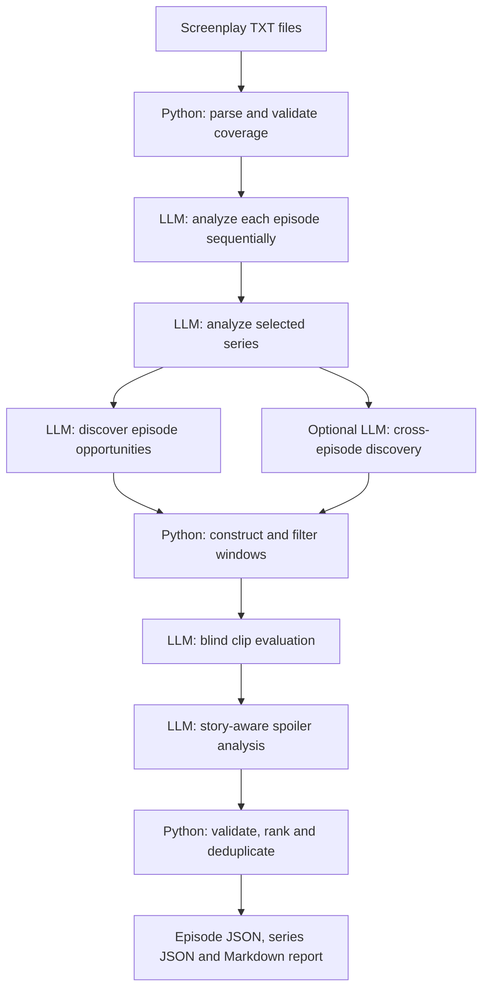

# PromoFinder

**Discover and rank promotional clips from timestamped microdrama screenplays.**

PromoFinder reads one screenplay per episode, identifies narrative opportunities,
constructs source-backed **20–60 second** clips, and exports ranked recommendations
for each episode and the series. LLMs assess story and creative quality; Python owns
timestamps, construction, validation, deduplication, and final scores.

The current release is a **sequential Python CLI and reusable library** implementing
the core of [PLAN.md](PLAN.md). It uses local files, typed contracts, configurable
model routes, and a filesystem cache.

> Output is a clip recommendation, not an edited video. Timestamps come from
> screenplays and must be checked against footage before editing. Model scores
> are editorial judgments, not measured audience performance.

## Contents

1. [Capabilities and scope](#1-capabilities-and-scope)
2. [Installation and quick start](#2-installation-and-quick-start)
3. [Input data contract](#3-input-data-contract)
4. [Architecture and execution](#4-architecture-and-execution)
5. [Configuration reference](#5-configuration-reference)
6. [Provider integration](#6-provider-integration)
7. [CLI and Python usage](#7-cli-and-python-usage)
8. [Outputs and data contracts](#8-outputs-and-data-contracts)
9. [Candidate construction and ranking](#9-candidate-construction-and-ranking)
10. [Caching, retries, and recovery](#10-caching-retries-and-recovery)
11. [Troubleshooting](#11-troubleshooting)
12. [Cost and runtime planning](#12-cost-and-runtime-planning)
13. [Development and verification](#13-development-and-verification)
14. [Data handling and operational limits](#14-data-handling-and-operational-limits)
15. [Roadmap](#15-roadmap)
16. [Repository map](#16-repository-map)

## 1. Capabilities and scope

| Capability | Current behavior |
| --- | --- |
| Screenplay ingestion | UTF-8 `.txt` files containing metadata, scenes, and timed events |
| Episode analysis | Summaries, characters, beats, revelations, and unresolved questions |
| Series analysis | Premise, arcs, and important revelations across selected episodes |
| Local discovery | Continuous clips using footage from a single episode |
| Cross-episode discovery | Optional, limited pass generating 2–3 ordered segments |
| Blind evaluation | Rates the clip without loglines, series summaries, or editorial concepts |
| Spoiler analysis | Separately assesses the clip against the known story |
| Ranking | Deterministic quality gates, weighted scores, and time-overlap suppression |
| Exports | Episode JSON, series JSON, intermediate artifacts, and a Markdown report |
| Provider routing | Ordered primary/fallback routes for each LLM stage |
| Reuse | Validated filesystem cache keyed by request content and settings |

The repository does **not currently include** a web UI, HTTP API, video ingestion,
video cutting, automatic context chunking, or semantic deduplication. The broader
plan describes future capabilities; this README documents the current implementation.

## 2. Installation and quick start

### 2.1 Prerequisites

- Python **3.11 or newer**.
- A terminal opened at the repository root.
- Provider credentials and network access for uncached LLM calls.
- No credentials are needed for local parsing or offline tests.

Runtime dependencies are Pydantic, HTTPX, and python-dotenv. Development tools are
pytest and Ruff. Requirements are declared in [pyproject.toml](pyproject.toml);
[uv.lock](uv.lock) records resolved dependency versions.

### 2.2 Install with uv

If uv is installed:

```shell
uv sync --extra dev --locked
uv run --locked python -m promofinder --parse-only
```

This uses the committed lockfile. The `dev` extra includes test and lint tools.

### 2.3 Install with pip

**Windows PowerShell:**

```powershell
python -m venv .venv
.venv/Scripts/python.exe -m pip install -e ".[dev]"
```

**macOS / Linux:**

```bash
python3 -m venv .venv
.venv/bin/python -m pip install -e '.[dev]'
```

Pip resolves the ranges in `pyproject.toml`; it does not consume `uv.lock`.
For runtime-only installation, omit `[dev]`.

Subsequent examples use Windows environment paths. On macOS/Linux, substitute
`.venv/bin/python`, or activate the environment and use `python` on either platform.

### 2.4 Configure credentials

Create `.env` from [.env.example](.env.example) if you do not already have one:

```powershell
Copy-Item .env.example .env
```

```dotenv
GROQ_API_KEY=your-groq-key
GEMINI_API_KEY=your-gemini-key
```

The CLI loads `.env` from the current directory. Existing environment variables
take precedence. Use `--env-file` to select another file.

One provider with valid credentials can serve all stages through the default
fallback routes, provided its model supports the requests. Configure both keys
to use the preferred provider at every stage. `.env` is ignored by Git.

### 2.5 Parse locally first

```powershell
.venv/Scripts/python.exe -m promofinder --parse-only
```

Inspect the printed run directory, especially `parsed/series_manifest.json` and
the `warnings` and `coverage` fields in parsed episode files. This step makes
**no LLM calls** and does not generate promos.

### 2.6 Run a small live trial

```powershell
.venv/Scripts/python.exe -m promofinder --limit 1
```

Inspect `status.json`, `outputs/episode_001_promos.json`, and `outputs/report.md`.
Once the single-episode result is useful, expand the run:

```powershell
.venv/Scripts/python.exe -m promofinder --limit 3
.venv/Scripts/python.exe -m promofinder
```

A limited run analyzes a **partial series**. Its spoiler judgments use only the
selected episodes and are not equivalent to full-series judgments.

## 3. Input data contract

### 3.1 File discovery and ordering

Put one screenplay per episode directly inside `data/`, or pass another directory
with `--data`. Discovery uses `*.txt` and is **not recursive**.

```text
data/
  episode-001-Episode 1671703.txt
  episode-002-Episode 1671704.txt
  ...
```

Episode identity comes from `EPISODE NUMBER` inside the file, not its filename.
Episode numbers must be unique. Episodes are sorted numerically after parsing.

**All discovered files are parsed before `--limit` is applied.** A fatal error in
a later file can therefore stop a `--limit 1` run. To isolate a subset at ingestion
time, place its files in a separate directory and use `--data`.

### 3.2 Supported screenplay format

This **synthetic example** illustrates the format, not a recommendation from the
supplied series:

```text
EPISODE NUMBER: Episode 1
EPISODE LOGLINE: An unexpected visitor brings a secret.
CONTINUITY NOTES: Opening episode.

--- SCRIPT START ---

SCENE 01
Scene heading: INT. HALL – DAY
Scene start: 00:00.00
Scene end: 00:40.00

Actions and dialogue:

**CAMERA:**
Start: (00:00.00) | End: (00:40.00)
A visitor confronts a woman in the doorway.

**WOMAN (Shocked):**
Start: (00:00.00) | End: (00:02.00)
"How did you find me?"

**VISITOR (Urgent):**
Start: (00:38.00) | End: (00:40.00)
"There is something you need to know."

--- SCRIPT END ---
```

| Element | Rules |
| --- | --- |
| Encoding | UTF-8, with or without a byte-order mark |
| Episode number | Required; duplicates stop the run |
| Logline and continuity notes | Metadata; absent values become empty strings |
| Scene | Unique number, heading, start, and end |
| Scene label casing | `Scene heading/start/end` and uppercase equivalents are supported |
| Event header | `**CAMERA:**`, `**ACTION:**`, sound labels, or `**CHARACTER (Delivery):**` |
| Sound labels | `SOUND FX`, `SOUND`, and `MUSIC` map to `sound` |
| Timing | `MM:SS`, `MM:SS.ss`, or `HH:MM:SS.ss`; up to millisecond precision |
| Event interval | Positive duration, entirely inside the declared scene |
| Event overlap | Allowed across camera, action, sound, and dialogue |
| Scene order | Scenes cannot overlap or move backward in time |
| End marker | Missing `--- SCRIPT END ---` produces an incompleteness warning |

Keep the event-header and `Start:` / `End:` syntax shown above. This is a parser
for the supplied screenplay format, not arbitrary prose or subtitle formats.

### 3.3 Coverage and incomplete source

Coverage is the union of valid event intervals. A declared scene end does not prove
that transcript content exists up to that point.

- Even a short uncovered interval remains a gap; there is no gap-filling tolerance.
- Each clip segment must fit inside a continuous coverage interval.
- A malformed event makes its scene unavailable for construction; valid parsed text
  and warnings remain available for inspection.
- `source.complete = false` does not disqualify every clip in an episode. Other
  fully covered intervals can still be used.
- Fatal errors, such as missing scene timing or no usable events, stop parsing.

Dataset verification found **50 episodes and 3,726 parsed events**, with coverage
warnings in 21 episodes, including one event outside its scene. These are observations
about the supplied data, not requirements imposed on new input.

## 4. Architecture and execution

### 4.1 Sequential workflow



Episode analyses run sequentially, followed by series analysis. Each episode then
undergoes discovery and construction. For each candidate, blind evaluation completes
before spoiler analysis. Ranking follows evaluation.

### 4.2 Responsibility boundaries

| Python owns | LLMs own |
| --- | --- |
| Parsing, IDs, hashes, source line numbers | Narrative summaries and story arcs |
| Timestamp arithmetic and coverage | Hook and ending opportunity selection |
| Clip boundaries, order, extraction | Standalone clarity and emotional judgments |
| JSON and evidence-reference validation | Whether an ending remains unresolved |
| Retries, routing, caching | Spoiler significance and damage judgments |
| Hard gates, scores, exports | Evidence-backed explanations |

An opportunity is not yet a valid candidate. A candidate is not yet an accepted
promo. Each transition has separate checks and artifacts.

### 4.3 Blind evaluation isolation

The blind evaluator receives the candidate ID, duration, segment order, and all
selected events with relative playback timestamps. It excludes loglines, continuity
notes, candidate concepts, and series analysis.

Spoiler analysis is a separate call with the clip, series analysis, and episode
revelations in source order. This keeps prior story knowledge out of the first-time
viewer's clarity assessment.

## 5. Configuration reference

[config.toml](config.toml) controls providers, routes, request settings, and output
limits. Unknown configuration fields are rejected. Routes must define exactly the
five LLM stages below, with at least one known provider in each route.

### 5.1 Default routing

| Route key | Primary | Fallback |
| --- | --- | --- |
| `episode_analysis` | Groq GPT-OSS 120B | Gemini Flash |
| `series_analysis` | Gemini Flash | Groq GPT-OSS 120B |
| `candidate_discovery` | Groq GPT-OSS 120B | Gemini Flash |
| `blind_evaluation` | Gemini Flash | Groq GPT-OSS 120B |
| `spoiler_analysis` | Gemini Flash | Groq GPT-OSS 120B |
| Final ranking | Python | No model call |

Local and cross-episode discovery share `candidate_discovery`. The checked-in
model IDs are `openai/gpt-oss-120b` and `gemini-3.8-flash`. These are configuration
values, not guarantees of access for every account.

### 5.2 Provider fields

| Field | Required / default | Meaning |
| --- | --- | --- |
| `base_url` | Required | API root; adapter appends `/chat/completions` |
| `api_key_env` | Required | Environment variable containing the API key |
| `model` | Required | Model identifier sent to the endpoint |
| `structured_output` | `"json_schema"` | Either `json_schema` or `json_object` |

Do not include `/chat/completions` in `base_url`. Store keys in environment
variables, not URLs or TOML.

### 5.3 LLM settings

| `[llm]` setting | Default | Allowed values / behavior |
| --- | --- | --- |
| `temperature` | `0.2` | Number from 0 to 2; sent to every provider |
| `max_tokens` | `8192` | Positive integer; maximum requested output tokens |
| `timeout_seconds` | `120` | Positive HTTPX timeout per request operation; not a whole-run deadline |
| `attempts_per_provider` | `2` | Integer from 1 to 3; includes the initial attempt |

Settings are shared across stages. Models must support the supplied parameters;
provider-specific parameter handling requires an adapter change.

### 5.4 Pipeline settings

| `[pipeline]` setting | Default | Meaning |
| --- | --- | --- |
| `series_id` | `"series_001"` | Identifier in analyses and results |
| `max_candidates_per_episode` | `12` | Positive cap on valid local candidates evaluated |
| `top_k_episode` | `5` | Maximum recommendations per episode |
| `top_k_series` | `10` | Maximum global recommendations |
| `cross_episode` | `false` | Enable limited cross-episode discovery |
| `max_cross_candidates` | `8` | Positive cap on cross-pass candidates |

Top-K values are maxima, not quotas. Invalid clips are never added to fill the list.
The cross-episode pass requires more than one selected episode.

### 5.5 Rules defined in code

These are **not TOML settings** in this version:

| Rule | Value | Implementation |
| --- | --- | --- |
| Clip duration | 20,000–60,000 ms | `CandidateBuilder` |
| Hook window | First 3,000 ms | Builder and ranker |
| Ending evidence window | Final 3,000 ms | `PromoRanker` |
| Maximum segments | 3 | Builder and series schema |
| Recovery beat intensity | At least 7/10 | `CandidateBuilder.episode()` |
| Minimum hook, cliffhanger, standalone ratings | 5/10 each | `PromoRanker.assess()` |
| Overlap suppression | At least 80% of the shorter clip | `PromoRanker.select()` |
| Score weights and penalty | See ranking section | `PromoRanker.assess()` |

## 6. Provider integration

### 6.1 Built-in adapter

`OpenAICompatibleProvider` sends synchronous Chat Completions requests through
HTTPX. It supports endpoints with the required request/response shape; native APIs
with different contracts need a custom adapter.

- `json_schema` requests strict structured output.
- `json_object` requests JSON and supplies the schema in the prompt.
- Both modes use local Pydantic and evidence validation.
- Empty, malformed, refused, or truncated completions are not accepted.

### 6.2 Add a compatible endpoint

Add a provider table, replacing the placeholders with your server's values:

```toml
[providers.local]
base_url = "http://localhost:8000/v1"
api_key_env = "LOCAL_LLM_API_KEY"
model = "your-model-id"
structured_output = "json_object"
```

Edit the existing route table:

```toml
[routes]
episode_analysis = ["local", "groq", "gemini"]
series_analysis = ["gemini", "local"]
candidate_discovery = ["local", "groq"]
blind_evaluation = ["gemini", "local"]
spoiler_analysis = ["gemini", "local"]
```

Do not duplicate `[routes]` in the TOML file. The adapter requires a nonempty key
variable even for local servers; use a placeholder only if your server does not
require authentication.

### 6.3 Implement a native provider

Implement the `LLMProvider` protocol in [llm.py](src/promofinder/llm.py):

```python
def generate(
    self,
    *,
    system: str,
    user: str,
    schema: dict,
    settings: LLMConfig,
) -> ProviderResponse:
    ...
```

An adapter must translate messages/schema/settings into its native API and return
`ProviderResponse(content=<JSON string>, usage=<optional dictionary>)`.
Raise `ProviderError(message, retryable=True)` for transient errors or
`ProviderError(message)` for permanent failures. Keep credentials out of error
messages and response metadata.

Configure a provider named `custom`, add it to the relevant routes, and inject your
implementation under the same name:

```python
# Integration fragment: native_adapter is your LLMProvider implementation.
router = LLMRouter(
    config,
    cache_dir=Path("runs/cache"),
    providers={"custom": native_adapter},
)
pipeline = PromoPipeline(config, Path("runs"), llm=router)
```

The provider still needs a valid TOML entry. Its configuration participates in cache
keys. Update model/configuration values or use a fresh cache when changing adapter
semantics.

## 7. CLI and Python usage

### 7.1 CLI reference

```text
python -m promofinder [--data DATA] [--config CONFIG] [--output OUTPUT]
                     [--env-file ENV_FILE] [--parse-only] [--limit LIMIT]
```

| Option | Default | Purpose |
| --- | --- | --- |
| `--data` | `data` | Directory containing screenplay files |
| `--config` | `config.toml` | TOML configuration path |
| `--output` | `runs` | Root for timestamped runs and shared cache |
| `--env-file` | `.env` | Environment file to load |
| `--parse-only` | Off | Write parsed artifacts; skip LLM stages |
| `--limit` | All episodes | First N episodes in numeric order; N must be positive |
| `--help` | — | Show command help |

Paths are relative to the working directory. Quote paths containing spaces.
The installed `promofinder` command accepts the same arguments.

```powershell
.venv/Scripts/python.exe -m promofinder --data "data" --output "runs/trial" --limit 2
.venv/Scripts/python.exe -m promofinder --config "config.toml" --env-file ".env" --parse-only
```

### 7.2 Library usage

```python
from pathlib import Path

from dotenv import load_dotenv

from promofinder.config import Config
from promofinder.pipeline import PromoPipeline

load_dotenv(".env", override=False)
config = Config.load(Path("config.toml"))
pipeline = PromoPipeline(config, output_dir=Path("runs"))

run_directory = pipeline.run(Path("data"), limit=1)
print(run_directory / "outputs" / "report.md")
```

Unlike the CLI, `PromoPipeline` does not load `.env` itself. Set the environment
before invoking it. For parsing only, call `run(..., parse_only=True)`.

### 7.3 Reusable classes

| Class | Main methods | Responsibility |
| --- | --- | --- |
| `ScreenplayParser` | `parse(path)` | Parse source into `ParsedEpisode` |
| `EpisodeAnalyzer` | `analyze(episode)` | Episode narrative analysis |
| `SeriesAnalyzer` | `analyze(series_id, analyses)` | Series synthesis |
| `CandidateDiscoverer` | `episode(...)`, `series(...)` | Source-referenced opportunities |
| `CandidateBuilder` | `build(...)`, `episode(...)`, `series(...)` | Source-valid windows |
| `PromoEvaluator` | `blind(...)`, `spoiler(...)` | Separate quality/spoiler judgments |
| `PromoRanker` | `assess(...)`, `select(...)` | Gates, scores, selection |
| `LLMRouter` | `call(...)` | Routing, validation, cache, retries |
| `PromoPipeline` | `run(...)` | Sequential orchestration and exports |

## 8. Outputs and data contracts

### 8.1 Artifact layout

Each invocation creates a separate **UTC-named** directory. The LLM cache is shared
under the chosen output root.

```text
runs/
  cache/
    <stage>/<request-hash>.json
    failures.jsonl
  <run-id>/
    config.json
    status.json
    parsed/
      series_manifest.json
      ep_001.json
      ep_001_aliases.json
    analysis/
      ep_001.json
      series.json
    discovery/
      ep_001.json
      series.json                    # optional cross-episode pass
    candidates/
      ep_001.json
      series.json                    # cross-pass candidates only
    evaluations/
      <candidate-id>_blind.json
      <candidate-id>_spoiler.json
    construction_diagnostics.json
    construction_rejections.json
    evaluation_failures.json
    outputs/
      episode_001_promos.json
      series_promos.json
      report.md
```

Artifacts appear as their stages complete. Parse-only writes configuration, status,
and parsed artifacts. Failed runs can contain partial artifacts.

**Read `outputs/series_promos.json` for global recommendations.**
`candidates/series.json` contains only the optional cross-episode pool; it can be
empty while global results contain valid episode clips.

### 8.2 Contracts and identifiers

[schemas.py](src/promofinder/schemas.py) is the authoritative contract reference.

| Contract | Content |
| --- | --- |
| `ParsedEpisode` | Metadata, source hash, scenes, events, coverage, warnings |
| `EpisodeAnalysis` | Summary, characters, beats, revelations, questions |
| `SeriesAnalysis` | Premise, source-referenced arcs, key revelations |
| `EpisodeDiscovery` / `SeriesDiscovery` | Typed opportunity collections |
| `PromoCandidate` | Ordered segments, duration, origin, overlapping clip events |
| `BlindEvaluation` | Hook, cliffhanger, clarity, emotion, weaknesses, explanation |
| `SpoilerEvaluation` | Significance, damage, reveals, resolution judgment |

- Episodes use IDs such as `ep_001`; event IDs such as `e_008` are local to an episode.
- Model evidence uses aliases such as `EP01:E8`; alias files map them to
  canonical IDs such as `ep_001:e_008`.
- Source timestamps are integer milliseconds on the episode timeline.
- Clip-event timestamps are relative to assembled playback, including earlier segments.
- Candidate IDs hash ordered episode/start/end segments. A source revision with
  unchanged coordinates can retain the ID; compare source hashes and runs as well.
- `promo_id` and `rank` are local to each result file, not global identifiers.

### 8.3 Ranked output example

This is **synthetic output illustrating the shape**. It is not a verified
recommendation from the supplied dataset.

```json
{
  "schema_version": "1.0",
  "series_id": "series_001",
  "scope": {"type": "episode", "episode_id": "ep_001"},
  "promos": [
    {
      "promo_id": "p_001",
      "rank": 1,
      "candidate_id": "c_example",
      "segments": [
        {"episode_id": "ep_001", "start_ms": 0, "end_ms": 40000}
      ],
      "duration_ms": 40000,
      "hook": {
        "description": "An unexpected visitor creates immediate tension.",
        "evidence_refs": ["EP01:E2"]
      },
      "cliffhanger": {
        "description": "The visitor's secret remains withheld.",
        "evidence_refs": ["EP01:E3"]
      },
      "why_it_works": "An unexpected arrival leads to an unanswered question.",
      "scores": {
        "hook": 8,
        "cliffhanger": 9,
        "standalone": 7,
        "emotion": 8,
        "spoiler_significance": 8,
        "spoiler_damage": 3,
        "final": 7.6
      },
      "warnings": ["Script timestamps; verify against video before editing."]
    }
  ],
  "construction": {
    "opportunities": 1,
    "candidates": 1,
    "rejected_windows_by_reason": {}
  },
  "rejected_candidates": []
}
```

Series output uses `scope: {"type": "series"}`, includes `partial_series`, and
ranks the union of local and cross-episode candidates. It does not include the
per-episode `construction` field. Global selection is independent of episode top-K lists.

### 8.4 Status and exit codes

| `status` | Meaning |
| --- | --- |
| `running` | Current stage; not a percentage-complete estimate |
| `parsed` | Parse-only invocation completed |
| `complete` | Workflow completed without recorded evaluation failures |
| `complete_with_errors` | Some evaluations failed; available results were exported |
| `failed` | Pipeline stopped; inspect `stage` and `error` |

A completed full run also records episode/candidate/evaluation counts,
`evaluation_failures`, `series_promos`, and an `outcome`:

| `outcome` | Interpretation |
| --- | --- |
| `promos_created` | At least one global recommendation was selected |
| `no_candidates` | No valid windows reached evaluation |
| `no_accepted_promos` | Candidates existed, but none reached final series selection |

**`complete` does not guarantee nonempty results.** Exit code `0` includes
successful parsing and completed workflows with valid empty outcomes. Handled
failures and `complete_with_errors` return `1`; invalid CLI arguments use argparse's
code `2`. Configuration errors can occur before a run/status file is created.

## 9. Candidate construction and ranking

### 9.1 Construction

1. Collect legal boundaries from event and scene start/end times.
2. Propose starts placing the hook within the first three seconds.
3. End at the ending anchor's end; do not pad arbitrarily into its resolution.
4. Require 20–60 seconds and continuous known source coverage.
5. Include every overlapping event and calculate relative playback intervals.
6. Reject partial dialogue and required context outside the window.
7. Deduplicate identical windows, sample opportunities round-robin, and cap the pool.

Recovery examines **every evidence anchor in every beat rated at least 7/10**,
pairing anchors with later event endings. These endings are proposals; the evaluator
must still decide whether they make convincing unresolved endings. Early anchors
crossing source gaps do not suppress usable later anchors.

### 9.2 Multi-segment construction

The optional cross-episode pass retrieves complete scenes around selected arc
beats. Retrieval is bounded to the first four arcs and first three beat references
per arc. It proposes a small number of combinations and explores a limited set of
starts for each group, allowing at most three segments.

Playback follows the segment array and may differ from episode order. Within one
episode, segments cannot replay footage or move backward. Total duration is the
sum of segment lengths, not overlapping source event durations.

### 9.3 Hard quality gates

The ranker rebuilds candidates from source, then requires:

- Matching candidate contents and evaluation IDs.
- Evidence references present in the selected clip.
- At least one cited hook event starting within the first three playback seconds.
- At least one cited ending event ending within the final three playback seconds.
- An ending judged unresolved by the blind evaluator.
- Hook, cliffhanger, and standalone scores of at least 5/10.
- No spoiler judgment that the clip resolves the central mystery.

A high arithmetic score does not override failed gates.

### 9.4 Score formula

All ratings are on a 0–10 scale:

```python
base = 0.30 * hook + 0.30 * cliffhanger + 0.25 * standalone + 0.15 * emotion
final = round(max(0.0, min(10.0, base - 0.15 * spoiler_damage)), 4)
```

Hook `8`, cliffhanger `9`, standalone `7`, emotion `8`, and spoiler damage `3`
produce **7.6**.

**Significance** describes a revelation's story importance. **Damage** describes
how much the clip removes a reason to keep watching. Only damage is penalized.

### 9.5 Selection

Promos are sorted by descending score, with candidate ID as a stable tie-breaker.
A clip is suppressed if it shares at least 80% of the shorter clip's duration with
a selected clip. Remaining selection is limited to K.

This is time-based suppression. Similar concepts in different scenes can still
recur; there is no semantic clustering or guaranteed scene quota.

## 10. Caching, retries, and recovery

### 10.1 Cache keys and records

Successful LLM responses are keyed by stage, provider/configuration, endpoint,
model, generation settings, schema, full system prompt, and user payload.
Episode timelines include the source SHA-256. Downstream stages are keyed by their
actual inputs.

Cache records retain validated output, request text, usage, successful-attempt
latency, attempt number, repair prompt, and prior failure summaries. Cached outputs
are revalidated; invalid entries are ignored and regenerated.

Parsing, construction, ranking, and exports are recomputed each run. Changing
inputs/settings invalidates the affected LLM requests; fresh model calls are not
guaranteed to reproduce earlier creative judgments.

### 10.2 Reruns

Rerun the same command to reuse applicable cached calls while writing a new run.
There is no resume-by-run-ID command or `--no-cache` flag.

For a separate cache and output history:

```powershell
.venv/Scripts/python.exe -m promofinder --limit 1 --output runs/fresh-trial
```

Routes are checked in order. The primary may be attempted before an existing
fallback cache entry is reached. A cached fallback does not guarantee zero network
attempts on the next run.

### 10.3 Retry policy

| Failure | Behavior |
| --- | --- |
| Missing API key | Move to the next provider |
| HTTP 429 or 5xx | Bounded exponential backoff, retry, then fallback |
| Transport failure / timeout | Retry within the limit, then fallback |
| Other HTTP errors | Move to the next provider |
| Empty, malformed, refused, or truncated response | Retry within the limit, then fallback |
| Schema/evidence validation error | Bounded repair feedback, then fallback |
| All providers fail during analysis/discovery | Stop the pipeline |
| All providers fail for a candidate evaluation | Record failure, exclude candidate, continue |

Two attempts means the initial attempt plus one retry. There is no adaptive rate
limiter or `Retry-After` scheduling. Failures are logged under `cache/failures.jsonl`.

## 11. Troubleshooting

### 11.1 No promos were created

| Observation | Inspect | Interpretation |
| --- | --- | --- |
| `candidates: 0` | Construction diagnostics/rejections | Windows failed construction or no opportunities were supported |
| Candidates exist, `evaluated: 0` | Evaluation failures and cache failure log | Evaluators failed |
| Evaluations exist, output empty | Output `rejected_candidates` | Hard gates rejected clips |
| Fewer than K results | Rejections and overlap exclusions | K is a maximum, not a quota |
| `candidates/series.json` empty | `outputs/series_promos.json` | The former contains only optional cross-pass candidates |

Discovery may find compelling **moments** shorter than 20 seconds. Their presence
does not mean valid clips were built. Recovery never fabricates coverage or guarantees
accepted promos.

Inspect a specific run in PowerShell:

```powershell
$runPath = 'runs/<run-id>'
Get-Content -LiteralPath "$runPath/status.json" -Raw
Get-Content -LiteralPath "$runPath/construction_diagnostics.json" -Raw
Get-Content -LiteralPath "$runPath/outputs/episode_001_promos.json" -Raw
```

Replace `<run-id>` with the directory printed by the CLI.

### 11.2 Rejection reasons

| Reason | Interpretation |
| --- | --- |
| `DURATION_OUT_OF_RANGE` | Under 20s or over 60s |
| `MISSING_SOURCE_COVERAGE` | Segment crosses a gap/unavailable region |
| `PARTIAL_DIALOGUE` | Boundary cuts a dialogue line |
| `UNSUPPORTED_BOUNDARY` | Boundary is not a parsed event/scene boundary |
| `REQUIRED_CONTEXT_OUTSIDE_CLIP` | Required context is not fully contained |
| `HOOK_OUTSIDE_OPENING` | Required/cited hook is outside the first three seconds |
| `SEGMENT_COUNT` | Outside the supported 1–3 segments |
| `UNKNOWN_EPISODE` | Episode absent from the run |
| `REPEATED_OR_REVERSED_FOOTAGE` | Same-episode segments overlap or move backward |
| `CANDIDATE_SOURCE_MISMATCH` | Candidate differs from source reconstruction |
| `EVALUATION_ID_MISMATCH` | Evaluation references another candidate |
| `UNKNOWN_EVIDENCE` / `UNKNOWN_SPOILER_EVIDENCE` | Cited event absent from clip |
| `ENDING_EVIDENCE_NOT_AT_END` | Cliffhanger evidence is outside the ending window |
| `ENDING_RESOLVED` | Blind evaluator judged the ending resolved |
| `WEAK_HOOK` / `WEAK_CLIFFHANGER` | Corresponding score below 5/10 |
| `LOW_STANDALONE_CLARITY` | Standalone score below 5/10 |
| `CENTRAL_MYSTERY_RESOLVED` | Central resolution disclosed |
| `EVALUATION_FAILED` | No provider produced a valid evaluation |
| `HEAVY_TIME_OVERLAP` | Higher-ranked selection already covers most footage |
| `OUTSIDE_TOP_K` | Valid clip falls outside the result limit |

Construction counters count **attempted windows**, not distinct ideas or final
promos. Many rejected windows can be normal during enumeration.

### 11.3 Common operational problems

**Repeated evaluation calls are usually different candidates, not an infinite loop.**
With the default pool of 12, each candidate needs a blind call and a spoiler call:
up to 24 successful calls before retries. Each stage can make two attempts on each
of the two configured providers. Timeouts, HTTP 503 responses, rate limits, and
schema repairs can therefore extend a sequential run considerably.

Logs identify the candidate, evaluation type, provider attempt, fallback, and elapsed
time. For example (illustrative):

```text
INFO Candidate 5/12 c_example: blind evaluation
INFO blind_evaluation/gemini: attempt 1/2 (timeout 120s)
INFO blind_evaluation: completed with gemini/gemini-3.8-flash in 8.2s
INFO Candidate 5/12 c_example: spoiler analysis
```

For shorter trial runs, lower `max_candidates_per_episode` to `3` in `[pipeline]`.
This reduces the evaluation pool and recall; changing top-K alone does not reduce
evaluation work. A running process uses the code/configuration it loaded at startup;
new progress logging applies on the next invocation. Completed successful requests
remain available in the cache when rerunning with matching inputs and settings.

| Symptom | What to check |
| --- | --- |
| `python` not recognized | Install Python or use the existing environment's explicit executable path |
| `No module named promofinder` | Install into the same interpreter with `python -m pip install -e ".[dev]"` |
| Missing key | `api_key_env`, selected environment file, environment-variable precedence |
| HTTP 401 / 403 | Credentials, endpoint, account access |
| HTTP 400 / 404 | Model ID, endpoint URL, request parameters, structured-output support |
| `ReadTimeout` | Whether a later attempt succeeded; adjust timeout if appropriate |
| HTTP 429 | Available provider capacity, request volume, cache reuse |
| Repeated validation errors | Stage payload and model suitability; try another route |
| Context-limit failure | Smaller input set for diagnosis; automatic chunking is unavailable |
| No files found | Working directory and `--data`; subdirectories are not scanned |
| Parse failure with `--limit 1` | All inputs are parsed first; isolate the file with `--data` |
| Many coverage rejections | Inspect gaps/malformed events; correct source timing only with source evidence |

A warning followed by `completed with ...` indicates recovery. Use final status
and artifacts to determine the invocation's actual outcome.

## 12. Cost and runtime planning

With cross-episode discovery disabled, a fresh successful run uses approximately:

```text
calls = N episode analyses + 1 series analysis + N discoveries + 2C evaluations
      = 2N + 1 + 2C
```

`N` is selected episodes and `C` is evaluated candidates. Repairs, retries, and
fallback add attempts; cache hits remove calls. An evaluation failure can prevent
the second evaluation call for that candidate.

| Episodes | Candidate cap at 12 per episode | Calls before retries, at the cap |
| --- | --- | --- |
| 1 | 12 | 27 |
| 3 | 36 | 79 |
| 50 | 600 | 1,301 |

Cross-episode mode can add one discovery call and up to twice
`max_cross_candidates` evaluation calls, subject to available scenes and deduplication.

Start with one episode and a lower candidate cap when testing a provider.
Increasing top-K alone does not expand the evaluation pool; increasing
`max_candidates_per_episode` does.

Sequential execution accumulates network latency. Cache records contain provider
token usage and successful-attempt latency, but there is no aggregate billing
report, dollar estimate, or run-wide budget. Failed attempts may incur usage not
captured in successful-response records.

## 13. Development and verification

### 13.1 Commands

```powershell
.venv/Scripts/python.exe -m pytest -q
.venv/Scripts/ruff.exe check src tests
.venv/Scripts/ruff.exe format --check src tests
```

To format source after edits:

```powershell
.venv/Scripts/ruff.exe format src tests
```

The most recent code verification passed **40 test cases**. Tests use injected
providers and mocked HTTP transport; no API keys or billable calls are required.
The dataset integration test reads local `data/` files.

### 13.2 Coverage

| Area | Covered behavior |
| --- | --- |
| Parser | Timestamps, metadata, Unicode, source lines, overlaps, sound, scenes, malformed/incomplete source |
| Construction | Coverage, duration, dialogue boundaries, ordered segments, cross-episode windows, later-anchor recovery |
| HTTP adapter | Structured payloads, auth headers, error classification, malformed/truncated completions |
| Router/cache | Fallback, bounded repair, evidence validation, reuse/invalidation |
| Evaluation/ranking | Blind-input isolation, score bounds, evidence timing, resolved endings, deduplication |
| Pipeline | Sequential execution, exports, cache reuse, evaluation failures, empty-candidate diagnostics |

Offline tests verify software behavior, not creative quality or every provider/model
combination.

### 13.3 Development conventions

- Keep timing and source validation deterministic in Python.
- Keep narrative prompts beside stage methods in `stages.py`.
- Update schemas and evidence validation together when changing model outputs.
- Add source-format regression cases when changing the parser.
- Test boundary/coverage rejection behavior when changing construction or ranking.
- Update documentation when flags, settings, artifacts, statuses, or supported behavior change.

### 13.4 Editor quality review

Review a representative sample for opening strength, boundary accuracy, independent
comprehensibility, unresolved endings, and actual spoiler damage. Record editor
accept/reject decisions with reasons. The generated report states that human review
has not been performed; it is not an editor-approved benchmark.

## 14. Data handling and operational limits

### 14.1 Data flow and storage

Parsing, construction, ranking, and artifact storage run locally. Uncached LLM
stages send the relevant screenplay/analysis payloads to configured endpoints.
Fallback can send the same task data to another provider in the route.

The built-in adapter reads keys from environment variables and does not persist
authorization headers or upstream error bodies. Configuration artifacts contain key
variable names, not key values. Custom adapters must handle their credentials likewise.

`runs/` contains screenplay text, prompts, analyses, outputs, and usage metadata.
It is ignored by Git but is not encrypted by the application. Custom output paths
or credentials filenames may need additional ignore entries.

### 14.2 Current limits

- Synchronous execution; no background job or distributed worker system.
- No supported concurrent-writer coordination for shared caches/output roots.
- No automatic context splitting or hierarchical series batching.
- No adaptive rate limiter or run-wide timeout/cost budget.
- No alignment between screenplay timestamps and actual video frames.
- No semantic deduplication or guaranteed scene/conflict diversity.
- Conservative gaps can reject intentional silence or transcript timing omissions.
- Partially intersected camera/action blocks retain their full text, which can mention
  actions outside the visible portion; verify footage before editing.
- Valid schemas and references do not guarantee correct creative judgments.
- Cached results can be reused, but fresh model calls need not reproduce previous judgments.

## 15. Roadmap

These are future extensions from the broader plan, **not implemented CLI features**:

| Area | Future work |
| --- | --- |
| Large inputs | Context-aware batching and hierarchical analysis |
| Editor workflow | FastAPI endpoints, upload flow, minimal review UI |
| Quality measurement | Editor-labeled benchmark and precision/recall reporting |
| Diversity | Semantic grouping and scene/conflict diversification |
| Boundaries | Source-validated optimization and video alignment |
| Operations | Aggregate usage/cost reporting and rate-limit scheduling |

See [PLAN.md](PLAN.md) for the original design and broader acceptance criteria.

## 16. Repository map

```text
.
├── data/                         # Source screenplays
├── src/promofinder/
│   ├── __init__.py               # Package version
│   ├── __main__.py               # Module entry point
│   ├── cli.py                    # Arguments, environment, exit codes
│   ├── config.py                 # Validated TOML settings
│   ├── schemas.py                # Data and LLM output contracts
│   ├── parser.py                 # Deterministic parser
│   ├── compact.py                # Aliases and clip serialization
│   ├── llm.py                    # Provider protocol, adapter, router/cache
│   ├── stages.py                 # Analysis, discovery, evaluation
│   ├── candidates.py             # Window construction and validation
│   ├── rank.py                   # Gates, formula, selection
│   ├── pipeline.py               # Sequential orchestration
│   ├── report.py                 # Markdown report
│   └── storage.py                # JSON and atomic file replacement
├── tests/                        # Offline and dataset integration tests
├── .env.example                  # Credential variable names
├── .gitignore                    # Environments, secrets, run artifacts
├── config.toml                   # Providers, routes, limits
├── pyproject.toml                # Metadata, dependencies, tooling
├── uv.lock                       # Resolved dependency versions
├── PLAN.md                       # Original design and future scope
└── README.md                     # Usage, behavior, operations, development
```
